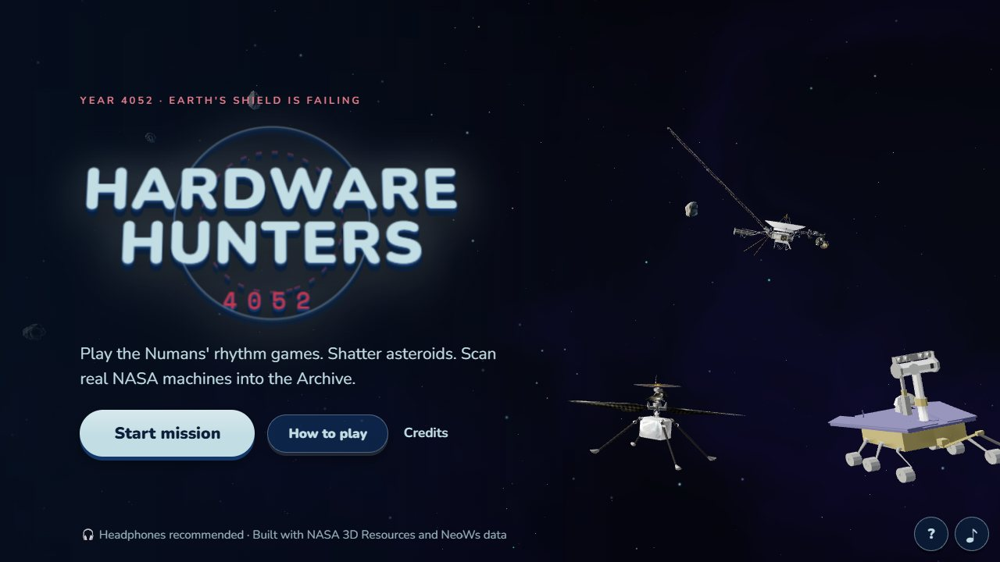
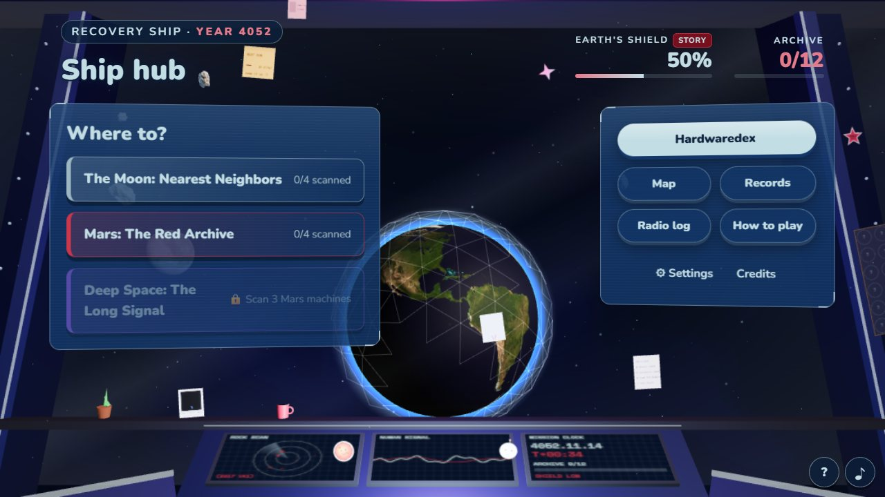
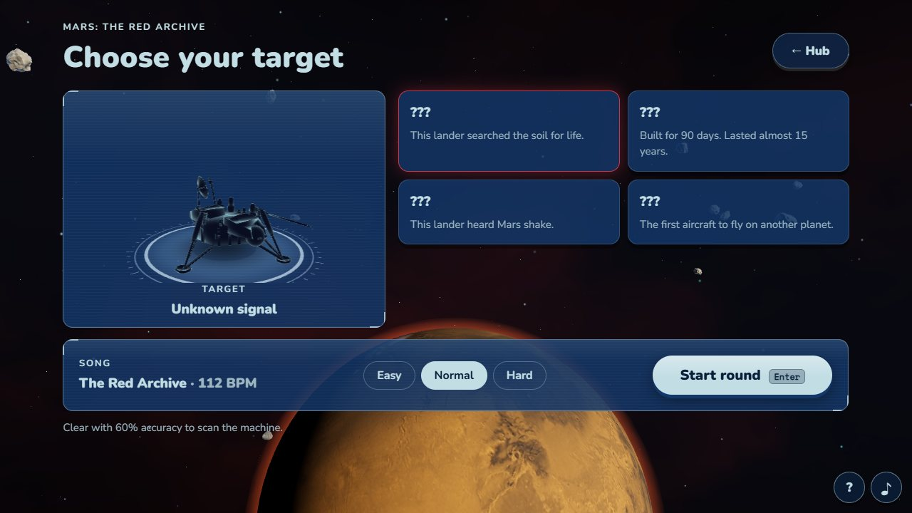
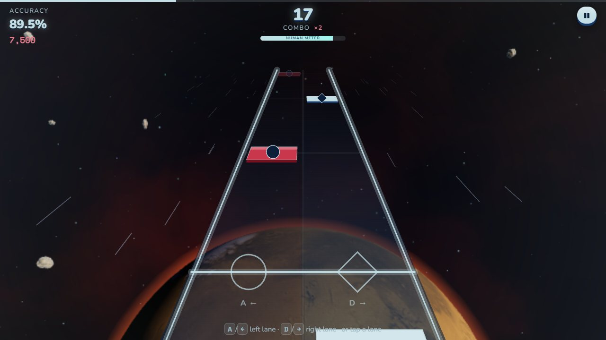
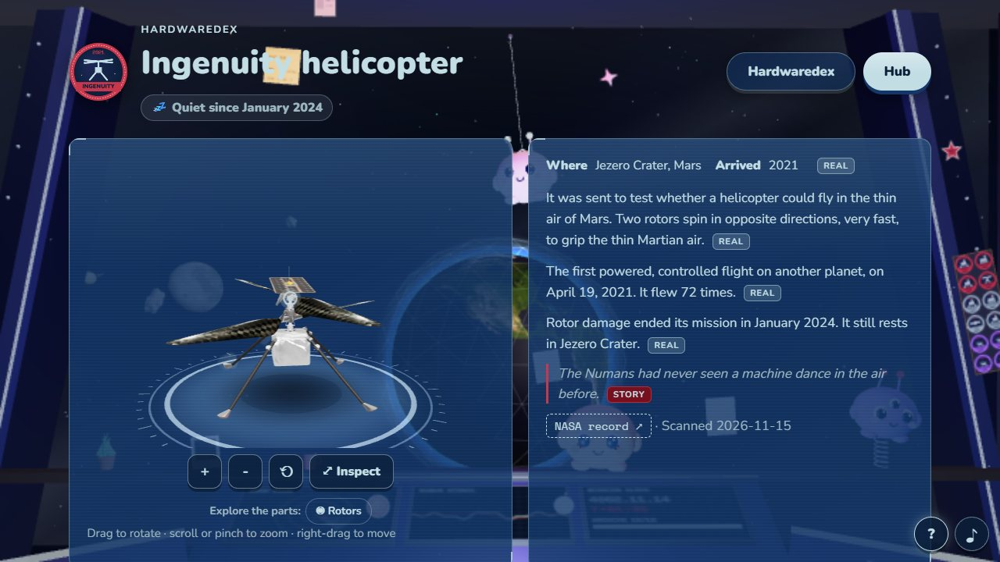
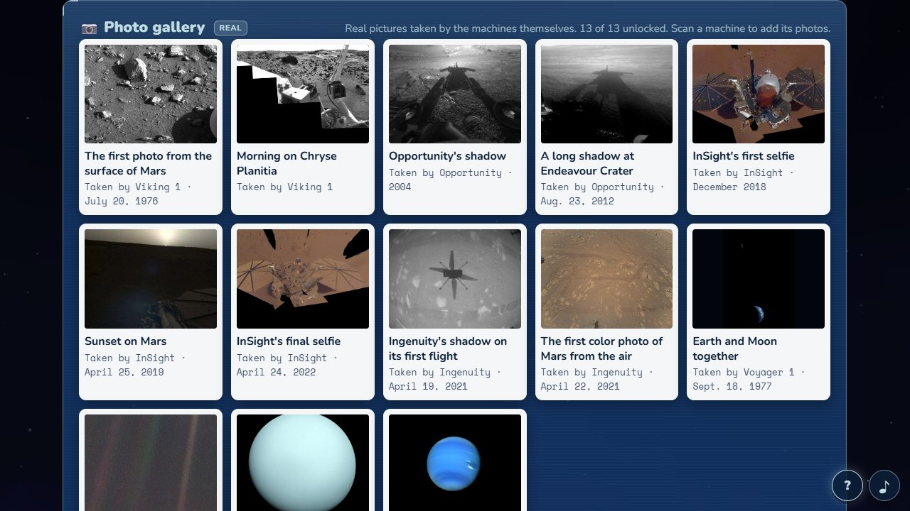
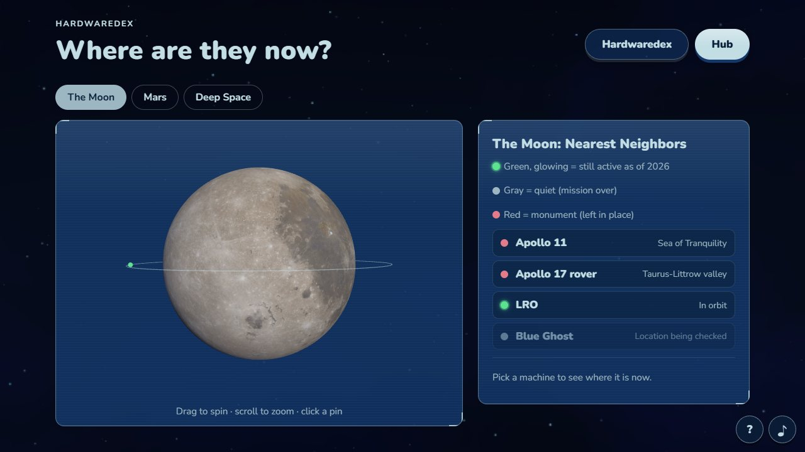

# Hardware Hunters 4052

*Space Dolphins · NASA Space Apps Challenge 2026*

A first-person rhythm game in the browser, for space fans aged 10 to 14.

It's the year 4052 and Earth's shield is failing. The Numans, a newly discovered life form, can
shatter incoming asteroids, but only while someone plays their two-lane rhythm games with them.
**Every round you clear scans a real NASA machine into the Archive:** Viking, Opportunity,
InSight, Ingenuity, Voyager and more, each shown as NASA's own 3D model with true mission facts
and real photos the machine took itself.

> The rhythm drives the story. The hardware teaches the science.



---

## What it does

| | |
|---|---|
|  | **Ship hub.** Your cockpit, with Earth and its failing shield in the window. Pick a region (the Moon, Mars or Deep Space), check the Earth's shield and your Archive, and open the Hardwaredex, the map, the record player or the radio log. |
|  | **Choose your target.** Each region has four real machines to find. Pick one and a difficulty (Easy, Normal or Hard). A short radio briefing from Mission Control sets the scene. |
|  | **Rhythm round.** Notes slide down two lanes: circles on the left, diamonds on the right. Hit them on the line. Perfect and Great hits fill the Numan meter, and a full meter sends a pulse that shatters a real near-Earth asteroid. |
|  | **Hardware card.** Clear the round to scan the machine. Spin and zoom NASA's 3D model, explore its parts, and read its story in plain words. Every line is tagged **Real** (from NASA) or **Story** (our fiction). |
|  | **Photo gallery.** Real pictures taken *by* the machines: Viking's first photo from Mars, InSight's selfies, Ingenuity's shadow on the first flight, Voyager's Earth and Moon. Each one says which camera took it and when. |
|  | **Where are they now?** A globe of the Moon and Mars with a pin at each landing site. Green, glowing pins are still active as of 2026. |

More screens: [loading screen with fun facts](docs/screenshots/loading.jpg) ·
[first-time ship tour](docs/screenshots/tour.jpg) · [How to play](docs/screenshots/how-to-play.jpg) ·
[radio briefing](docs/screenshots/briefing.jpg) · [photos on a card](docs/screenshots/card-photos.jpg) ·
[full-size photo](docs/screenshots/photo-view.jpg) · [Hardwaredex](docs/screenshots/hardwaredex.jpg)

## How to play

| Action | Keys |
|---|---|
| Left lane (circle notes) | **A** or **←**, or tap the left lane |
| Right lane (diamond notes) | **D** or **→**, or tap the right lane |
| Hold notes | keep the key held until the tail ends |
| Pause | **Esc** or **P**, or the ❚❚ button |

- **Perfect** within 50 ms, **Great** within 100 ms, **Good** within 150 ms. Anything later is a Miss.
- Clear with **50%** accuracy on Easy, **60%** on Normal and Hard, to scan the machine.
- Grades: S ≥ 95%, A ≥ 85%, B ≥ 70%, C below.
- The Moon and Mars are open from the start. Scan 3 Mars machines to unlock Deep Space.

New players get a guided **ship tour** of every button the first time they reach the hub, and a
**How to play** walkthrough before their first round. Both can be skipped and replayed: the **?**
button (bottom right) opens How to play on any screen, and Settings has "Replay the ship tour".
The **♪** button turns the menu background music on or off.

**Settings** (hub → ⚙): volumes, note speed, audio offset (for Bluetooth headphones), graphics
quality, one-lane mode (any key hits every note), reduced motion, easy-read font, read radio
lines aloud. Playtesters can type the tester code `nasa` in Settings to unlock everything.

## Set it up

You need **[Node.js](https://nodejs.org) 20 or newer**.

```bash
git clone https://github.com/musfiratpx/spacedolphins.git
cd spacedolphins
npm install
npm run dev        # open the link it prints (usually http://localhost:5173)
```

Other commands:

```bash
npm run build      # production build in dist/ (plain static files)
npm run preview    # serve dist/ locally to test the build
```

Don't open `index.html` by double-clicking it. The game loads its data files over HTTP, so it
needs a web server (`npm run dev`, `npm run preview`, or any static host).

### Deploying

`npm run build` makes a `dist/` folder with relative paths, so it runs from any static host:
GitHub Pages, Netlify (build command `npm run build`, publish directory `dist`), or a plain web
server. No backend and no secrets are needed to play.

### Optional: refresh the real asteroid data

The game ships with a saved snapshot of real near-Earth asteroids from NASA's NeoWs service
(`data/asteroids.json`), so it never depends on the API being up. To refresh it:

```bash
cp .env.example .env              # Windows PowerShell: Copy-Item .env.example .env
# put your free key from https://api.nasa.gov/ in .env:  NASA_API_KEY=your-key
node scripts/fetch-asteroids.js   # writes data/asteroids.json
```

`DEMO_KEY` works for a quick test but is heavily rate-limited. `.env` is git-ignored. Never rename
the key to `VITE_...`, because Vite would bake it into the public website.

## How it works

A static website: JavaScript modules read plain JSON data files. No server, no database.
**Vite** bundles the code, **Three.js** draws the 3D world and NASA models, and **Web Audio**
plays all the music and sound.

### The music and the notes always line up

- The songs are **written as code** (`data/songs/*.json`): drum patterns, bass lines and melodies,
  played live by Web Audio synthesizers, with real NASA recordings layered on top (a marsquake,
  Ingenuity's rotor hum, Saturn's radio emissions…).
- The **note charts are generated from the same score** the music plays, so a note can never
  drift away from its sound. Easy, Normal and Hard use different tracks of the same song.
- All timing uses the **audio clock** (`AudioContext.currentTime`), never the frame rate. A
  lookahead scheduler queues sounds slightly ahead. Key presses are judged at the moment they
  happened, even if the browser was busy drawing a frame.
- During a **data break**, the beat drops out and a real NASA recording plays. Its loudest peaks
  become the notes.

### Real vs Story

| Real (from NASA) | Story (our fiction) |
|---|---|
| Every machine, place, date, discovery and status on a card | The year 4052, Earth's shield, the asteroid threat |
| NASA 3D models, planet textures, sounds and photos | The Numans and their songs |
| Asteroid names, sizes and speeds from NeoWs | Sound in space (space is silent!) |

Every piece of text in the game is tagged **Real** or **Story**. Card facts come only from the
NASA page linked on each card. Anything not yet checked is marked `TODO_VERIFY` in the data and
left out of the game.

### Performance

- A loading screen (with fun facts) shows real progress while textures and models load, and
  warms up the graphics so the first camera move doesn't stutter.
- The background world redraws at half rate on menus and a third during rounds, so the note
  lanes get the frame budget.
- Graphics resolution adapts to the frame rate automatically (Settings → Graphics → Auto).

### Project layout

```
index.html               page shell + loading screen
src/
  main.js                boot, loading progress, screen registry (registerScreen / go)
  core/                  event bus, feature flags, settings, saved progress, asset manifest, data loading
  audio/                 audio clock, sequencer, synths, NASA sample player, chart generator, sound effects
  rhythm/round.js        lanes, input, judging, scoring and drawing for a round
  three/                 3D world + cockpit, hardware model viewer, map globe, thumbnails
  screens/               title, intro, hub, preround, round, results, card, dex, map, records, radio log, credits
  ui/                    photos, How to play, ship tour, radio overlay, mission patches, helpers
  styles.css
data/
  hardware.json          regions + 12 machines (card text, sources, hotspots)
  photos.json            real photos taken by the machines (caption, camera, date, credit, NASA link)
  songs/                 the three song scores
  radio.json             radio script
  asteroids.json         NeoWs snapshot
assets/
  manifest.json          every model, sound, texture and photo with its source URL and credit
  models/  photos/  sounds/  textures/
scripts/                 fetch-asteroids.js, song generators, model conversion
docs/screenshots/        the images in this README
```

### Editing content

- **Card text:** `data/hardware.json`. Plain words, about 25 words per field, facts only from the
  linked NASA page. Unknowns stay `TODO_VERIFY`.
- **Photos:** add the image to `assets/photos/` and an entry to `data/photos.json` (machine,
  caption, camera, date, credit, NASA link). Scanning that machine unlocks it in the gallery.
- **Radio lines:** `data/radio.json`.
- **Music:** `data/songs/`. Drum patterns are 16-character strings (`x` hit, `o` accent, `.` rest);
  melodies are 16 tokens per bar (`"D4"`, `"-"` rest, `"_"` hold). The `chart` block picks which
  tracks become notes, on which lane, from which difficulty.
- **Models and sounds:** drop the file into `assets/` with the name listed in
  `assets/manifest.json`. No code changes needed. A missing file shows a marked placeholder.

## Accessibility

Left notes are circles and right notes are diamonds, so color is never the only cue. Body text is
16 px or larger. Every effect respects **reduced motion**, with at most 3 flashes per second.
There's also an easy-read font, a one-lane mode, read-aloud radio lines, an audio-offset
calibration and full keyboard play.

## Roadmap and rules

- [ROADMAP.md](ROADMAP.md): what's built, phase by phase
- [CLAUDE.md](CLAUDE.md): the project's rules, data formats and verified facts

## Team

| Role | Owner |
|---|---|
| Game lead | TBD |
| 3D and design | TBD |
| Content and accuracy | TBD |
| Audio and charts | TBD |
| Data | TBD |
| Demo and submission | TBD |

## Credits and licenses

See [CREDITS.md](CREDITS.md) for every NASA model, texture, sound and photo, with its source
and credit line. NASA media is generally not copyrighted but is credited anyway. NASA's insignia
and logotype are not used, and NASA does not endorse this project. All music is original (written
as code). Three.js and Vite are MIT-licensed; Nunito and Space Mono are under the SIL Open Font
License.
